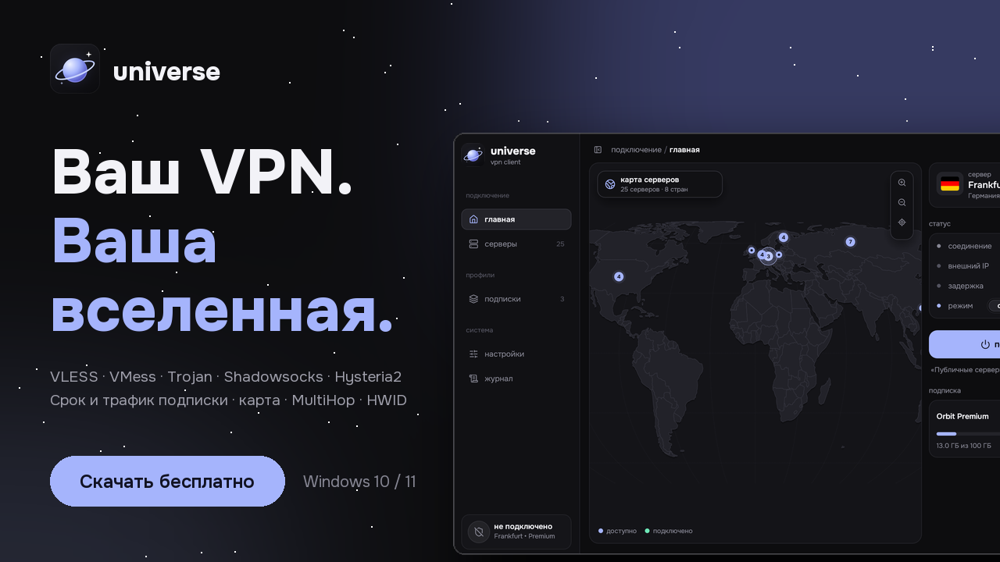
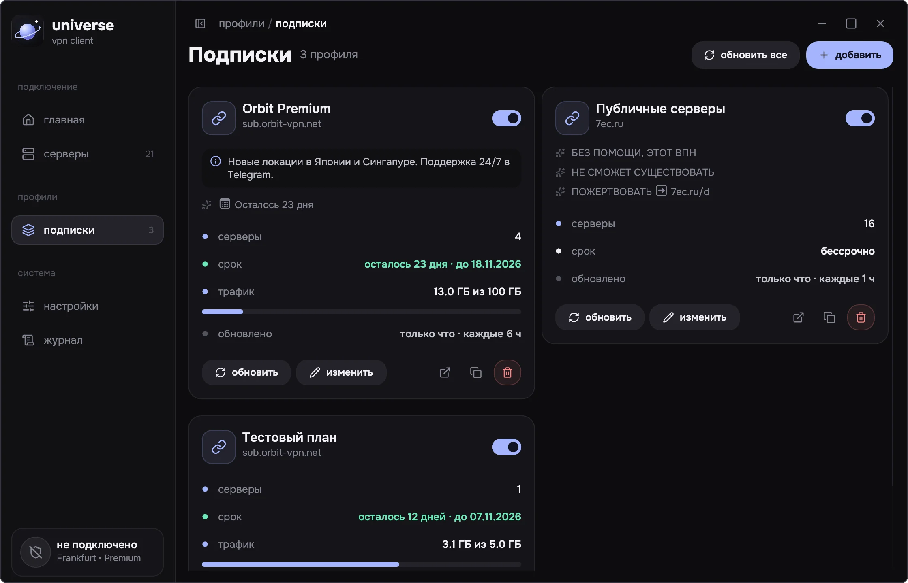
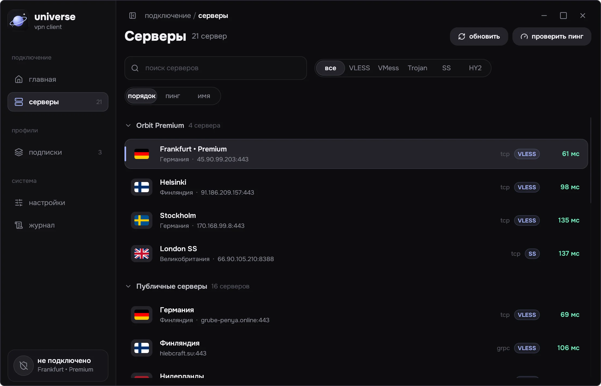
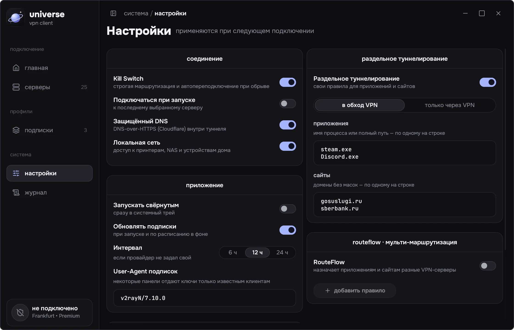
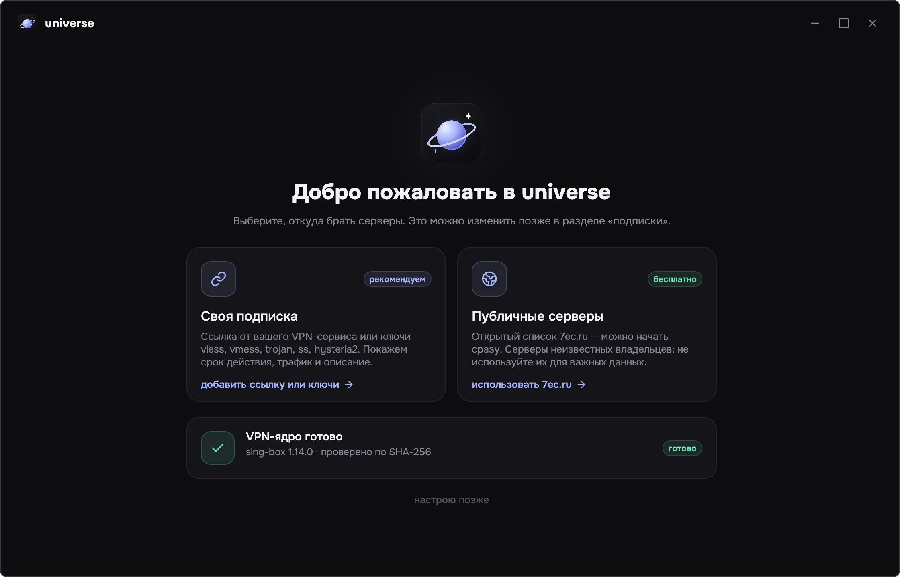

<p align="center">
  
</p>

<h1 align="center">universe</h1>

<p align="center">
  <b>Ваш VPN. Ваша вселенная.</b><br>
  Нативный VPN-клиент для Windows: ваши подписки и ключи, срок и трафик подписки,<br>
  карта серверов, MultiHop и раздельное туннелирование — без Electron.
</p>

<p align="center">
  <a href="https://github.com/bUmmy1337/universe-client/releases/latest"></a>
  <a href="https://github.com/bUmmy1337/universe-client/actions/workflows/windows.yml"></a>
  
  
  
  <a href="LICENSE"></a>
</p>

<p align="center">
  <a href="https://github.com/bUmmy1337/universe-client/releases/latest"><b>Скачать</b></a> ·
  <a href="#возможности">Возможности</a> ·
  <a href="#быстрый-старт">Быстрый старт</a> ·
  <a href="#сборка-из-исходников">Сборка</a> ·
  <a href="#faq">FAQ</a>
</p>

<p align="center">
  
</p>

## Возможности

**Подписки как они есть**
- 🔗 **Свои подписки и ключи.** Ссылки `https://…`, импорт-ссылки Happ, v2RayTun, Hiddify и
  Streisand, ключи `vless://`, `vmess://`, `trojan://`, `ss://`, `hysteria2://` — списком или в base64.
  Тип ввода определяется сам, а <kbd>Ctrl</kbd>+<kbd>V</kbd> в любом месте окна открывает импорт.
- 📅 **Всё о подписке на виду.** Срок, остаток трафика, название, описание и интервал обновления
  из заголовков панелей Marzban, Remnawave, 3x-ui и других (`subscription-userinfo`,
  `profile-title`, `announce`, `profile-update-interval`, `support-url`).
- 🧩 **JSON-подписки.** Конфиги Xray JSON и sing-box JSON превращаются в обычные серверы.
- 🪪 **HWID, как в Happ и Incy.** Для сервисов с лимитом устройств передаются `x-hwid`,
  `x-device-os`, `x-ver-os` и `x-device-model`.
- 🔄 **Автообновление** при запуске и в фоне — по интервалу, который задал провайдер.
- ⚠️ **Заметки и предупреждения.** Текст из «фейковых» серверов («Осталось 23 дня») показывается
  заметкой. Скорое окончание срока или трафика подсвечивается на главной.

**Подключение**
- 🌍 **Карта мира** с геолокацией серверов, группировкой по странам и регионам и анимацией маршрута.
- 🛰️ **MultiHop** — цепочка из двух серверов в разных странах.
- 🔀 **Раздельное туннелирование и RouteFlow** — приложения и сайты в обход VPN, только через VPN
  или через отдельный сервер.
- 🛡️ **Kill Switch** со строгой маршрутизацией и переподключением по нарастающей задержке.
- 📈 **Живая статистика**: скорость, трафик сеанса и внешний IP.
- ⚡ **Пинг всех серверов** параллельно, сортировка по задержке, запоминание последнего сервера.

**Приложение**
- 🪶 Нативный exe на Rust и egui, ~15 МБ, без Electron и браузерного движка.
- 🎨 Тёмный интерфейс с акриловым фоном, сворачиваемая боковая панель, системный трей.
- 👋 Экран приветствия: своя подписка или бесплатные публичные серверы, пока скачивается ядро.

## Скриншоты

<table>
  <tr>
    <td></td>
    <td></td>
  </tr>
  <tr>
    <td align="center"><b>Подписки</b> — срок, трафик и описание</td>
    <td align="center"><b>Серверы</b> — группы, фильтры и пинг</td>
  </tr>
  <tr>
    <td></td>
    <td></td>
  </tr>
  <tr>
    <td align="center"><b>Настройки</b> — Kill Switch, DNS, туннелирование, HWID</td>
    <td align="center"><b>Первый запуск</b> — выбор источника серверов</td>
  </tr>
</table>

<sub>На скриншотах демонстрационные данные.</sub>

## Быстрый старт

1. Скачайте `universe.exe` из [последнего релиза](https://github.com/bUmmy1337/universe-client/releases/latest).
2. Запустите его. Windows попросит права администратора: они нужны для TUN-интерфейса.
3. При первом запуске universe скачает VPN-ядро [sing-box](https://github.com/SagerNet/sing-box)
   и проверит его по SHA-256.
4. Вставьте ссылку на подписку или ключи. Нет подписки — выберите публичные серверы.
5. Выберите сервер на карте или в списке и нажмите **подключить**.

## Что поддерживается

| | |
|---|---|
| **Протоколы** | VLESS (Reality, TLS, Vision, XUDP), VMess, Trojan, Shadowsocks (AEAD, 2022, obfs, v2ray-plugin), Hysteria2 (salamander) |
| **Транспорты** | TCP, WebSocket, gRPC, HTTP/2, HTTPUpgrade, QUIC |
| **Форматы подписок** | список ссылок, base64, Xray JSON, sing-box JSON |
| **Импорт-ссылки** | `happ://add/`, `v2raytun://import/`, `hiddify://import/`, `streisand://import/`, `sing-box://import-remote-profile` |
| **Данные подписки** | `subscription-userinfo`, `profile-title`, `announce`, `profile-update-interval`, `support-url`, `profile-web-page-url`, `content-disposition` |
| **Устройство** | `x-hwid`, `x-device-os`, `x-ver-os`, `x-device-model` |

## HWID

Некоторые сервисы ограничивают число устройств и без идентификатора отдают заглушку
«Требуется идентификатор устройства». universe передаёт HWID по умолчанию:

- он **постоянный** — это SHA-256 от `MachineGuid` Windows с солью приложения, поэтому переустановка
  universe не занимает новый слот устройства;
- **сам `MachineGuid` не передаётся**, только хэш;
- в настройках HWID можно скопировать, сбросить на случайный или отключить совсем.

## Сборка из исходников

Нужны [Rust](https://rustup.rs/) и Visual Studio Build Tools с компонентом
**Desktop development with C++**.

```powershell
git clone https://github.com/bUmmy1337/universe-client.git
cd universe-client
.\build-windows.ps1
```

Скрипт прогонит тесты и соберёт `dist\universe.exe`. Вручную:

```powershell
cargo test
cargo build --release --target x86_64-pc-windows-msvc
```

Проверить, что sing-box принимает сгенерированные конфиги для вашей подписки:

```powershell
$env:SING_BOX_CHECK = "C:\path\to\sing-box.exe"
$env:UNIVERSE_FEED = "C:\path\to\subscription.txt"
cargo test --test feed
```

## Как это устроено

```
src/
├── main.rs          состояние приложения, подписки, подключение, события
├── pages.rs         экраны: главная с картой, серверы, подписки, настройки, журнал
├── welcome.rs       экран первого запуска
├── theme.rs         палитра, шрифты и виджеты
├── map.rs           карта Natural Earth, проекция Equal Earth, анимация маршрута
├── native_tray.rs   системный трей Windows
├── parser.rs        разбор share-ссылок (VLESS, VMess, Trojan, SS, Hysteria2)
├── json_config.rs   Xray JSON и sing-box JSON → share-ссылки
├── subscription.rs  загрузка подписок, заголовки панелей, форматирование
├── device.rs        HWID и сведения об устройстве
└── singbox.rs       конфиг sing-box, TUN, MultiHop, RouteFlow, установка ядра
```

Подключение выполняет **sing-box**: universe собирает конфиг с TUN-интерфейсом для всего
компьютера, проверяет его через `sing-box check` и запускает ядро. Скорость и трафик читаются из
локального Clash API ядра.

## Где хранятся данные

Всё хранится только локально, в `%LOCALAPPDATA%\universe\data`:

| Файл | Что внутри |
|---|---|
| `settings.json` | настройки и список подписок (ключи, добавленные вручную, тоже здесь) |
| `subscriptions\<id>.txt` | последний загруженный список серверов каждой подписки |
| `server-locations.json` | кэш геолокации серверов |
| `sing-box.json` | конфиг активного подключения |
| `core\sing-box.exe` | VPN-ядро |

## FAQ

<details>
<summary><b>universe — это VPN-сервис?</b></summary>
Нет, это клиент. Серверы даёт ваш VPN-сервис по ссылке на подписку или ключам.
</details>

<details>
<summary><b>Безопасны ли публичные серверы?</b></summary>
Это серверы неизвестных владельцев из открытого списка 7ec.ru. HTTPS-трафик остаётся зашифрованным,
но владелец узла видит метаданные соединений. Не используйте их для важных данных.
</details>

<details>
<summary><b>Подписка пишет «Требуется идентификатор устройства»</b></summary>
Проверьте, что в настройках включено «Передавать HWID», и что в подписке не исчерпан лимит
устройств.
</details>

<details>
<summary><b>Подписка не загружается или пустая</b></summary>
Некоторые панели отдают ключи только известным клиентам. В настройках можно поменять
User-Agent подписок (по умолчанию <code>v2rayN/7.10.0</code>).
</details>

<details>
<summary><b>Зачем права администратора?</b></summary>
Чтобы создать TUN-интерфейс и системные маршруты — так через VPN идёт трафик всех программ.
</details>

## Лицензия

Код universe распространяется по лицензии [MIT](LICENSE).

- [sing-box](https://github.com/SagerNet/sing-box) — отдельный проект под GPLv3, скачивается с
  официального репозитория при первом запуске.
- Шрифты [Onest](https://fonts.google.com/specimen/Onest) и [JetBrains Mono](https://github.com/JetBrains/JetBrainsMono) — SIL Open Font License.
- Иконки — [Lucide](https://lucide.dev) (ISC), карта — [Natural Earth](https://www.naturalearthdata.com) (public domain).
